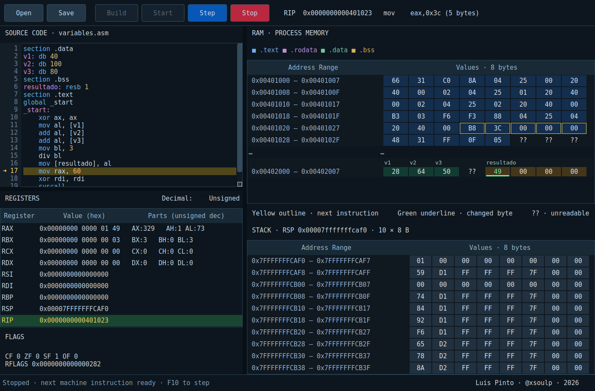

# ASM101

A native C++20 / Qt 6 Widgets visual debugger for NASM x86-64 Linux programs. Uses NASM, GNU ld and a real asynchronous GDB/MI2 session.



## Install the Debian package (Ubuntu 24.04 amd64)

Download the `.deb` from the [v1.0.1 release](https://github.com/xsoulp/assembly_debugger_101/releases/tag/v1.0.1). Open a terminal in the download folder and run:

```sh
sudo apt install ./asm101_1.0.1-1_amd64.deb
```

APT installs the declared Qt 6, NASM, binutils and GDB dependencies. Launch ASM101 from the applications menu or run `asm101`. The installed example is in `/usr/share/asm101/examples/`; Save/Build prompts for an editable copy when that file is read-only.

## Build and run (Ubuntu 24.04)

```sh
sudo apt-get install build-essential cmake ninja-build qt6-base-dev nasm binutils gdb
cmake -S . -B build -G Ninja
cmake --build build
./build/asm101
```

The included `examples/example.asm` opens at startup. Open another `.asm` file with Ctrl+O. Save with Ctrl+S. Build (F7), Start (F5), then Step (F10) to execute exactly one machine instruction. Stop is Shift+F5. GDB stops at a temporary `_start` breakpoint before the first instruction. Source remains read-only while building or debugging. Unsaved edits can be saved or discarded when opening another file or closing.

Build saves the editor contents and runs `nasm -f elf64 -g -F dwarf` and `ld` asynchronously, using a temporary directory for object/executable artifacts. It never substitutes generated source. Rebuild after changing the source. NASM includes resolve relative to the source directory. The current version supports static, non-PIE ELF64 executables with `_start`.

## What the displays mean

- Registers contain actual GDB values, as 64-bit hex. RAX/RBX/RCX/RDX also show their low word, high byte and low byte (`AX   AH AL` through `DX   DH DL`) in decimal. The Unsigned/Signed toggle beside the register heading switches between unsigned values and two’s-complement signed values at each part’s own width (8 or 16 bits). Hexadecimal values and the process state stay unchanged. Green backgrounds mark changes since the preceding stop; RIP is yellow.
- CF, ZF, SF, OF come from EFLAGS/RFLAGS. Changed flags turn green until the next stop.
- The source gutter shows a yellow execution arrow and highlights the DWARF source line. Instruction stepping can remain on the same source line.
- Memory uses real ELF `.text`, `.rodata`, `.data`, `.bss` bounds and section colors per byte, including boundaries inside rows. Noncontiguous regions have an ellipsis separator. Addresses outside those sections are not synthesized as zeros.
- Variable labels from the executable’s ELF symbols appear above their first byte in `.data`, `.rodata` and `.bss`. Hover a label for its full name and address. Long labels are shortened to fit before the next label; aliases share a label. Only annotated rows gain height. Names require an executable with its symbol table intact.
- The stack panel is anchored at the lower right: ten rows of eight real bytes with the initial RSP on the bottom row and lower addresses above it. Addresses stay fixed throughout each run, so PUSH/POP and other writes update bytes in place and highlight changes to previously observed bytes. Reads use one 80-byte block, with per-row fallback if part is unreadable. Unknown or unreadable bytes remain `??`.
- Yellow byte outlines identify the next instruction using GDB disassembly opcode length. Green underlines mark changed bytes in cached memory. `??` means unreadable or not yet fetched.
- Memory is fetched on demand in blocks of up to 256 bytes, split at section boundaries. Up to 128 cached pages are retained. Cached blocks refresh on stops; newly visited pages have no prior observation against which to mark changes. Scrolling stays in place when stepping. Large sections are represented as rows without allocating their entire contents.

Plain `MOV` instructions animate the transferred hexadecimal value between visible operands for 450 ms after GDB confirms the stop. Loads travel from RAM to the exact register byte range (including AL/AH/AX/EAX); stores travel back to RAM; immediates start at the source operand in the editor. Register-to-register moves are supported for displayed register families. The value is read from the actual destination after the instruction and checked against the original source register/immediate when available. Memory addressing supports absolute addresses and 64-bit base/index/displacement or RIP-relative addresses from GDB’s Intel disassembly. Other instruction variants or unavailable/offscreen endpoints skip the animation. Step stays disabled until completion; Stop, resizing or scrolling cancels the animation without executing another instruction. Ordinary register and memory change indicators remain visible. `ADD` also animates its second operand toward the first, prefixed with `+`. Its original operands are captured before stepping (with asynchronous GDB memory reads when needed); the animation only runs after the actual destination matches the addition at the correct operand width.

The status bar reports build and execution state; errors appear in native dialogs. Inferior terminal input/output is not presented in this first version. Stop terminates GDB and its inferior; there is no separate pause control. Source-level breakpoint management, editing process state, multithreaded and remote debugging are outside this version's scope.

## Build the Debian package (Ubuntu 24.04)

To build the package locally on Ubuntu 24.04, install the build dependencies first:

```sh
sudo apt-get update
sudo apt-get install build-essential cmake ninja-build qt6-base-dev nasm binutils gdb
./packaging/build-deb.sh
```

The Qt runtime libraries installed by the `.deb` do not include the development files needed to compile the application.

The package and `SHA256SUMS` are written to `dist/`. GitHub Actions builds, tests and publishes these files to the v1.0.1 release. The `v1.0.1` tag identifies the source used to build the current release assets.

## About the author

Created by **Luis Pinto** · [@xsoulp](https://github.com/xsoulp) · 2026.

Contact: [xsoulp@gmail.com](mailto:xsoulp@gmail.com).
