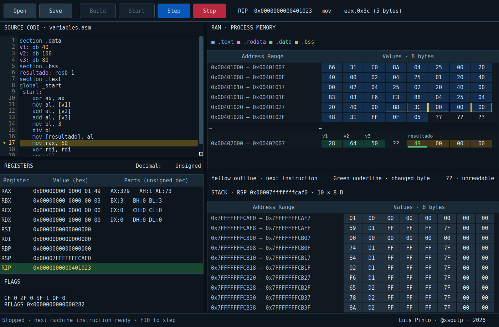
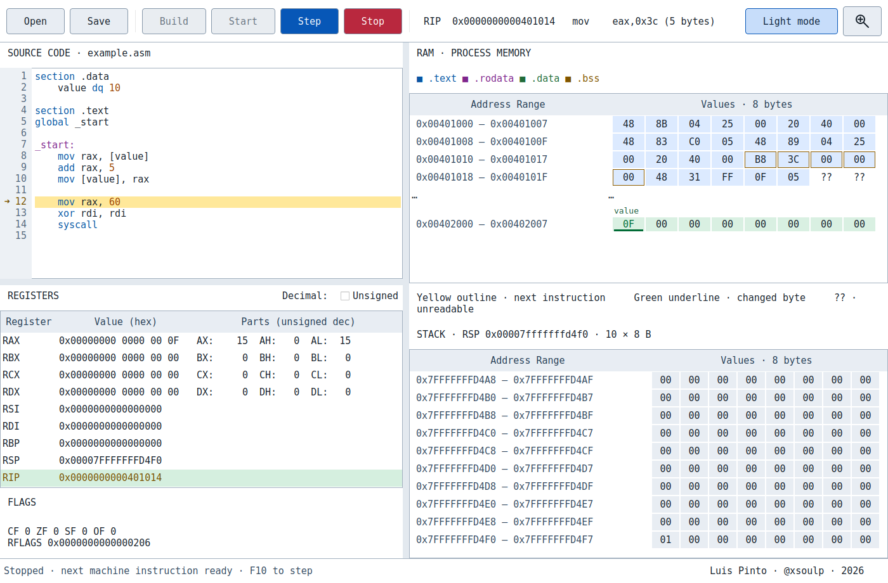

# ASM101

A native C++20 / Qt 6 Widgets visual debugger for NASM x86-64 Linux programs. Uses NASM, GNU ld and a real asynchronous GDB/MI2 session.

**Dark mode**



**Light mode (white background)**



## Install and launch (Ubuntu 24.04 amd64)

Download the `.deb` package from the **Assets** section of the [latest release](https://github.com/xsoulp/assembly_debugger_101/releases/latest). Open a terminal in the folder containing the downloaded package and install it:

```sh
sudo apt install ./asm101_*_amd64.deb
```

APT installs the required dependencies. Launch **ASM101** from the applications menu, or run:

```sh
asm101
```

## Build and run (Ubuntu 24.04)

```sh
sudo apt-get install build-essential cmake ninja-build qt6-base-dev nasm binutils gdb
cmake -S . -B build -G Ninja
cmake --build build
./build/asm101
```

To build the Debian release package, also install `imagemagick`, then run:

```sh
cmake -S . -B build-deb -G Ninja -DCMAKE_BUILD_TYPE=Release -DCMAKE_INSTALL_PREFIX=/usr -DASM101_BUILD_PACKAGE=ON
cmake --build build-deb
ctest --test-dir build-deb --output-on-failure
cpack --config build-deb/CPackConfig.cmake -B dist
```

Version tags publish the tested `.deb` and its `SHA256SUMS` file to GitHub Releases.

The included `examples/example.asm` opens at startup. Open another `.asm` file with Ctrl+O. Save with Ctrl+S. Build (F7), Start (F5), then Step (F10) to execute exactly one machine instruction. Stop is Shift+F5. GDB stops at a temporary `_start` breakpoint before the first instruction. Source remains read-only while building or debugging. Unsaved edits can be saved or discarded when opening another file or closing.

Right-click **Start** or press **F11** to show the **Arguments** text field. Type arguments such as `hello 42 "two words"`, then use Start normally. Spaces separate arguments; single or double quotes group text, and empty quotes pass an empty argument. Backslash escapes the next character except inside single quotes. Values are passed literally, including `$`, `*` and shell punctuation. Unclosed quotes or a trailing backslash report an error before launch. Enter or F11 hides the field while retaining its contents for subsequent runs; clear it to run without arguments. Arguments are read-only during a session. In a Linux x86-64 program at `_start`, `[rsp]` contains `argc`, `[rsp+8]` points to `argv[0]` (the executable name), and `[rsp+16]` points to `argv[1]`. See `tests/arguments.asm` for a minimal example.

Use **Light mode** in the top-right corner to switch to a white background with dark text for classroom projection. Click it again to return to dark mode. Both themes include syntax colours, execution highlights, registers, RAM and stack.

The magnifying-glass button beside it doubles the content font size. Click again to restore normal size. It works in both themes; enlarged tables can be scrolled when needed.

Build saves the editor contents and runs `nasm -f elf64 -g -F dwarf` and `ld` asynchronously, using a temporary directory for object/executable artifacts. It never substitutes generated source. Rebuild after changing the source. NASM includes resolve relative to the source directory. The current version supports static, non-PIE ELF64 executables with `_start`.

## What the displays mean

- Registers contain actual GDB values, as 64-bit hex. RAX/RBX/RCX/RDX also show their low word, high byte and low byte (`AX   AH AL` through `DX   DH DL`) in decimal. The Unsigned/Signed toggle beside the register heading switches between unsigned values and two’s-complement signed values at each part’s own width (8 or 16 bits). Hexadecimal values and the process state stay unchanged. Green backgrounds mark changes since the preceding stop; RIP is yellow.
- CF, ZF, SF, OF come from EFLAGS/RFLAGS. Changed flags turn green until the next stop.
- The source gutter shows a yellow execution arrow and highlights the DWARF source line. Instruction stepping can remain on the same source line.
- Memory uses real ELF `.text`, `.rodata`, `.data`, `.bss` bounds and section colors per byte, including boundaries inside rows. Noncontiguous regions have an ellipsis separator. Addresses outside those sections are not synthesized as zeros.
- Click a colored legend entry to hide or show its section. The coral **stack** entry toggles the stack panel. Filters remain in effect across steps, restarts, and theme changes.
- Variable labels from the executable’s ELF symbols appear above their first byte in `.data`, `.rodata` and `.bss`. Hover a label for its full name and address. Long labels are shortened to fit before the next label; aliases share a label. Only annotated rows gain height. Names require an executable with its symbol table intact.
- The stack panel is at the lower right. Drag the horizontal divider between RAM and STACK to resize their panels. Scroll down to inspect higher addresses beyond RSP, including `argc`, `argv` and environment pointers, or up for lower addresses. Each row shows eight bytes in a virtual window extending 64 KiB below and above the initial RSP; the first view brings RSP into sight. Addresses stay fixed throughout each run, so PUSH/POP and other writes update bytes in place and highlight changes to previously observed bytes. Stack pages load on demand in 256-byte blocks with per-row fallback when a block crosses unreadable memory. Up to 128 pages are cached and refreshed on stops. Unknown or unreadable bytes remain `??`. Resizing and scrolling work in both themes and at both font sizes.
- The stack view centers on **RSP** at Start and whenever an instruction changes RSP. Each wheel notch or scrollbar arrow click moves one row. Click **stack (RSP)** or **base (RBP)** in the stack heading to center that pointer after scrolling. In the address column, RSP is gold and RBP is underlined. Bold **stack** and **base** labels sit below their exact bytes; both labels appear when the pointers share a byte. A byte label is shown only when that pointer lies inside the displayed stack range; RBP is not initialized as a frame pointer automatically. Hover an address for its exact pointer values.
- Yellow byte outlines identify the next instruction using GDB disassembly opcode length. Green underlines mark changed bytes in cached memory. `??` means unreadable or not yet fetched.
- Click an individual byte in RAM or the stack to toggle just that byte between hexadecimal and ASCII. Click it again to restore hex. Printable ASCII bytes show their character; space shows `␠`, NUL/tab/newline/carriage return show `\0`, `\t`, `\n`, `\r`, and other control or non-ASCII bytes show `·`. Hover for the exact address, hex, decimal and ASCII interpretation. This changes the display only. Each byte's choice survives stepping, scrolling, section filters and theme changes, and resets to hex on a new run. Symbol labels, pointer labels, addresses and unreadable bytes do not toggle.
- Memory is fetched on demand in blocks of up to 256 bytes, split at section boundaries. Up to 128 cached pages are retained. Cached blocks refresh on stops; newly visited pages have no prior observation against which to mark changes. Scrolling stays in place when stepping. Large sections are represented as rows without allocating their entire contents.

Plain `MOV` instructions animate the transferred hexadecimal value between visible operands for 450 ms after GDB confirms the stop. Loads travel from RAM to the exact register byte range (including AL/AH/AX/EAX); stores travel back to RAM; immediates start at the source operand in the editor. Register-to-register moves are supported for displayed register families. The value is read from the actual destination after the instruction and checked against the original source register/immediate when available. Memory addressing supports absolute addresses and 64-bit base/index/displacement or RIP-relative addresses from GDB’s Intel disassembly. Other instruction variants or unavailable/offscreen endpoints skip the animation. Step stays disabled until completion; Stop, resizing or scrolling cancels the animation without executing another instruction. Ordinary register and memory change indicators remain visible. `ADD` also animates its second operand toward the first, prefixed with `+`. Its original operands are captured before stepping (with asynchronous GDB memory reads when needed); the animation only runs after the actual destination matches the addition at the correct operand width.

Stack loads through `MOV` animate from the addressed stack byte to the destination register. `PUSH` and `POP` animate 16-bit and 64-bit register and memory transfers, including AX, SP/RSP, R8–R15, and copies between memory locations. Values are captured before execution and checked against the destination afterward. `PUSH [rsp]` reads from the original RSP, while `POP [rsp]` calculates its destination after RSP advances. Participating registers and bytes are brought into view for stack animations. Immediate pushes show the usual green stack/register change highlights without a transfer animation.

The **STDOUT** panel at the bottom left shows the program's standard output as UTF-8 text, including writes without a newline. It has a resizable divider, Clear and Hide buttons. Press **F9** or use **View → Stdout** to hide or restore it; hidden output continues to be captured. Output remains after exit or Stop and clears on the next Start. The viewer retains up to 5,000 lines and 1 MiB of text. Stdout is captured separately from GDB's control messages; stderr and interactive stdin are not shown. Library-buffered output appears when the program flushes it. This is a plain-text viewer, without terminal escape-sequence processing.

The status bar reports build and execution state; errors appear in native dialogs. Stop terminates GDB and its inferior; there is no separate pause control. Source-level breakpoint management, editing process state, multithreaded and remote debugging are outside this version's scope.

## About the author

Created by **Luis Pinto** · [@xsoulp](https://github.com/xsoulp) · 2026.

Contact: [xsoulp@gmail.com](mailto:xsoulp@gmail.com).
