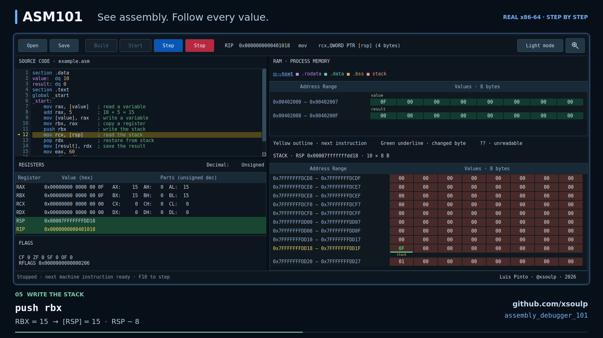

# ASM101 LinkedIn demo

[Watch or download the 15-second video](https://github.com/xsoulp/assembly_debugger_101/raw/refs/heads/main/docs/demo/asm101-linkedin-15s.mp4)

[](https://github.com/xsoulp/assembly_debugger_101/raw/refs/heads/main/docs/demo/asm101-linkedin-15s.mp4)

`asm101-linkedin-15s.mp4` is a 15-second, 1920 × 1080, 30 fps H.264 video with
burned-in English captions. It has no audio and works with sound off.
`asm101-linkedin-cover.png` is a matching cover image.

The footage captures the real ASM101 Qt widgets, GDB execution, and built-in
transfer animations. `example.asm` loads a variable containing 10, adds 5,
writes the variable, copies a register, pushes to the stack, reads through RSP,
pops to a register, and saves 15 to `result`. The recording checks those values
against the live debugger and verifies that POP restores RSP. Unused register
rows are hidden for readability, and the app's `.text` memory filter keeps the
two variables visible above the stack. The application's source files are unchanged.

To recreate the video, install the usual ASM101 build dependencies plus Qt Test
and FFmpeg, then run from the repository root:

```sh
bash docs/demo/render.sh
```

The separate recording executable builds under `build/linkedin-demo`. Rendering
uses Qt's offscreen platform, so it does not need a desktop session.
